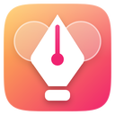

# Design Kit

**Charte d'un site (couleurs, polices, export .ase), SVG, moodboard, règle et captures responsive.** · version 1.0.0 · catégorie : Création & productivité

## Fonctionnalités

- Couleurs classées par rôle (fond, texte, accent), variables CSS et polices
- Export .ase, .svg, CSS ou JSON
- Récupération des icônes et logos SVG de la page
- Moodboard par client, exportable en PDF
- Règle ⌥⇧R, grille de colonnes, captures pleine page en 390, 820, 1440 et 1920 px

## Installation

1. Ouvre `chrome://extensions` (ou `edge://extensions`).
2. Active le **Mode développeur**.
3. Clique sur **Charger l'extension non empaquetée** et choisis ce dossier (`extensions/11-design-kit`).

Hôte local requis : Non.

## Utilisation

Ouvre l'extension sur un site : onglets Charte, SVG, Moodboard et Mesure. Clic droit sur une image › « Ajouter au moodboard ».

Raccourcis : ⌥⇧R : Activer / couper la règle

## Permissions

| Permission | Pourquoi |
|---|---|
| `scripting` | Injecte un script d'analyse ou d'insertion dans la page, seulement à ta demande. |
| `downloads` | Enregistre les fichiers dans Téléchargements › Web Media. |
| `storage` | Garde tes réglages et ton historique dans le stockage local du navigateur. |
| `unlimitedStorage` | Le contenu enregistré (images, citations, bibliothèque) peut dépasser le quota de 10 Mo. Il reste sur ta machine. |
| `contextMenus` | Ajoute ses entrées au clic droit. |
| `debugger` | Simule plusieurs largeurs d'écran (protocole DevTools) pour les captures responsives. Chrome affiche un bandeau pendant l'opération. |
| `offscreen` | Ouvre un document invisible pour les traitements que le service worker ne peut pas faire (encodage, conversion, assemblage de fichiers). |
| `<all_urls>` | Récupère les images ajoutées au moodboard et les SVG externes du site analysé, et capture l'onglet. |

## Confidentialité

Tout reste sur ta machine : stockage local du navigateur et dossier Téléchargements › Web Media. Aucune statistique, aucune télémétrie, aucun serveur de l'auteur.

---
Fait partie d'[Aruzen Web Media](../../README.md) · Licence [PolyForm Noncommercial 1.0.0](../../LICENSE.md)
